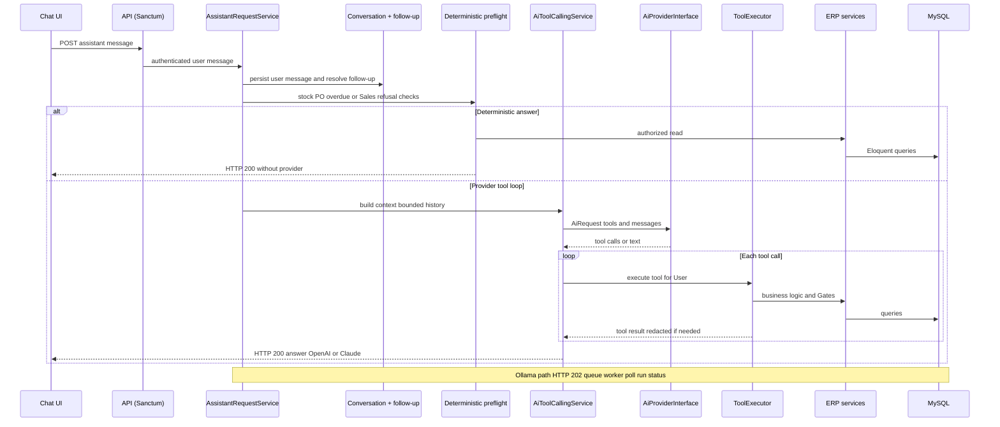
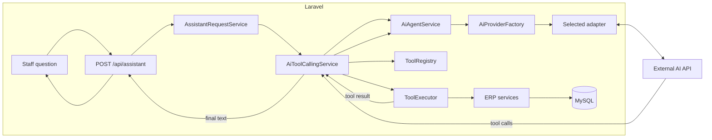

# Stone ERP AI Assistant

A **Laravel 12** application that exposes an **ERP-aware AI assistant** over a **Sanctum-authenticated JSON API**, with a minimal **Vite + Tailwind** chat UI. **Sales** and **Purchasing** roles are enforced with Laravel **Gates**, ERP **services**, and **AI tools** — not by model prompts alone.

**Interviewer-facing documentation (Word):** see `docs/submission/` for **seven** DOCX files — reference summaries, setup, testing, demo, acceptance, and a technical interview handbook (regenerated with `python tools/build_phase13_submission.py` and `python tools/build_phase16_interview_handbook.py`; requires `python-docx`, `matplotlib`, `pillow`). Regenerating does not require live AI APIs or Docker.

### Challenge Part 3 checklist (README)

| Requirement | Section in this README |
|-------------|-------------------------|
| Setup + two test users | [Setup](#setup-and-two-demo-users-required) |
| Architecture (question → DB) | [Architecture and request flow](#architecture-and-request-flow-required) |
| Integration into existing ERP | [Integrating with an existing Laravel ERP](#integrating-with-an-existing-laravel-erp-required) |
| AI cost per 1,000 questions | [Estimated AI cost](#estimated-ai-cost-per-1000-questions-required) |
| Freight split / landed cost | [Landed-cost formula](#landed-cost-formula-value-based-freight-required) |
| Future improvements | [What would improve with more time](#what-would-improve-with-more-development-time-required) |

**Security and business-rule guarantees:** the model never runs SQL; tools call Laravel ERP services; Gates and `ToolExecutor::allowedFor` enforce Sales vs Purchasing; draft POs require explicit HTTP confirmation; supplier bank data is encrypted; deterministic grounding paths (stock counts, PO status, Purchasing supplier-overdue replies, Sales refusals) can answer without trusting model text alone.

---

## Business problem

Operational staff need quick answers about **slab inventory**, **purchase-order status**, **overdue orders**, and (for **Purchasing**) **landed cost** and **draft purchase-order proposals** — without writing SQL. The assistant must respect **role boundaries**: Sales cannot see costs, bank details, or confirm purchase orders.

## Key features

- **Sanctum** bearer-token API (`POST /api/auth/token`, then `Authorization: Bearer …`).
- **ERP read APIs**: products, stock, purchase orders, overdue POs; **landed cost** (Purchasing).
- **Assistant** (`POST /api/assistant`) with **tool calling** (role-filtered tool set per provider).
- **Conversation persistence** and **follow-up resolution** (e.g. Houston → Dallas) in MySQL.
- **Draft PO proposals** with **explicit HTTP confirmation** and **idempotency** (no auto-confirm).
- **Ollama-only async assistant** (Phase 16.6): Redis queue + `ProcessOllamaAssistantRun` + status polling when `AI_PROVIDER=ollama`.
- **Supplier-specific overdue PO search** (Purchasing) and **Sales soft denial** for that analysis (Phase 16.22+), with conversation follow-up fixes (16.23).
- **Procurement**: warehouse destination clarification, supplier–product catalogue validation, pending clarification state, proposal-first PO creation.
- Optional **Docker Compose** stack (`Dockerfile`, `docker-compose.yml`) — **runtime not verified** on the primary dev machine.
- **Not implemented:** Amazon Bedrock, Google Gemini, Groq adapters (`AiProviderFactory` throws if configured).

## Technology stack (see `composer.json` / `package.json`)

| Layer | Stack |
|--------|--------|
| Backend | PHP ^8.3 (see `composer.json`), Laravel ^12, Sanctum ^4.3 |
| AI | `openai-php/laravel`, drivers in `app/Services/AI/Providers` (OpenAI, Claude, Ollama) |
| Redis client | `predis/predis` ^3.7 |
| DB | MySQL 8 |
| Frontend | Vite 6, Tailwind 4, vanilla JS (`resources/js/chat`) |

## Architecture and request flow (required)

The assistant never queries MySQL directly. The AI provider may **propose** tool calls; **Laravel** validates arguments, checks roles, runs `AiToolInterface` implementations, and returns structured results to the model for a final answer (or returns a **deterministic** ERP reply without calling the provider when preflight rules match).



**Numbered flow (synchronous OpenAI/Claude path):**

1. User sends a question from the chat UI (`resources/js/chat`).
2. `Authorization: Bearer` Sanctum token → `User` with `Sales` or `Purchasing` role.
3. `POST /api/assistant` → `AssistantController` → `AssistantRequestService`.
4. Message appended to `conversation_messages`; optional `Idempotency-Key` replay when `conversation_id` is present.
5. `FollowUpQuestionResolver` / `DeterministicFollowUpResolver` expand short follow-ups (warehouse, supplier, PO id).
6. Deterministic preflight may return immediately (ERP-backed text, clarification, or Sales refusal).
7. `ConversationContextManager` builds bounded message history (+ summary when present).
8. `AiProviderFactory::make()` selects OpenAI, Claude, or Ollama from `AI_PROVIDER`.
9. `AiToolCallingService` loops: provider → tool calls → `ToolRegistry` definitions filtered by role.
10. `ToolExecutor` strips forbidden keys, validates JSON schema, checks `allowedFor(User)`, runs tool.
11. ERP services (`StockLookupService`, `PurchaseOrderLookupService`, `LandedCostService`, …) query via Eloquent.
12. Tool results returned to the provider for the next turn; token usage logged when available.
13. Final assistant text persisted; JSON returned to the client (or **202 + run_id** for Ollama).
14. **Ollama only:** `ProcessOllamaAssistantRun` on Redis; client polls `GET /api/assistant/runs/{runId}`.

- **Controllers / routes:** `routes/api.php` (prefix `/api`).
- **Providers:** `app/Contracts/AiProviderInterface.php`, `app/Services/AI/AiProviderFactory.php`, `app/Services/AI/Providers/*`.
- **Tools:** `app/Services/AI/Tools/` — fixed registry; server executes tools.
- **Frontend (Ollama):** HTTP **202** on accept, then poll until `completed` or `failed`; `sessionStorage` recovery (run id, user id, message text — not the bearer token).

## AI provider behaviour

| Provider | Request behaviour | Queue worker |
|----------|-------------------|--------------|
| **Ollama** | **Asynchronous:** persist user message → create `assistant_runs` row → dispatch `ProcessOllamaAssistantRun` to Redis → **HTTP 202**; inference in a **separate worker** | **Required** when using Ollama (`scripts\queue-worker.cmd`) |
| **OpenAI** | **Synchronous:** full tool-calling loop in the HTTP request → **HTTP 200** | Not used for assistant |
| **Claude** | **Synchronous:** same as OpenAI | Not used for assistant |

**Why Ollama is async:** local models can exceed comfortable HTTP timeouts; the API accepts work quickly and moves long inference to a worker with a **900s** job timeout. **OpenAI/Claude** remain synchronous to preserve existing challenge behaviour, latency profile, and test fakes without queue semantics.

**Clarifications** (follow-up needs more detail): **HTTP 200** synchronously; no `assistant_runs` row — see `AssistantRequestService::finalizeClarification`.

**Warehouse slab counts (production grounding):** questions such as “how many … slabs in Houston/Dallas/Austin” force an initial `checkStock` tool hop, then the API **re-validates** the model’s count against ERP (`StockCountGroundingEnforcer`). Parsed filters run a deterministic `StockLookupService` lookup so answers match `slabs_on_hand` (e.g. 2 cm Calacatta in Austin → **0**, not a guessed number). Toggle with `AI_ASSISTANT_ENFORCE_STOCK_GROUNDING` (default **true**).

Details: `docs/PHASE16.6C-ASYNC-ASSISTANT-OPERATIONS.md`, Phase 16.6F audit limitations in handbook Section Y.

## AI provider abstraction and vendor independence

Agent orchestration is **independent of the AI vendor**. Each provider adapter translates internal `AiRequest` / `AiResponse` DTOs into that vendor’s HTTP API (including function/tool calling and continuation after tool results). You switch providers through **`AI_PROVIDER`** in `.env` without rewriting controllers, ERP services, or tool business logic. **Authorization and business rules stay in Laravel** regardless of which model is selected.

Setting `AI_PROVIDER=gemini`, `bedrock`, or `groq` today does **not** work — `AiProviderFactory` throws `AiProviderException` until a matching adapter class exists.

### Components

| Component | Role |
|-----------|------|
| **`AiProviderInterface`** (`app/Contracts/AiProviderInterface.php`) | Single method: `complete(AiRequest): AiResponse`. Keeps orchestration and tools vendor-agnostic. |
| **`AiProviderFactory`** | Reads `config('ai.provider')` from `AI_PROVIDER`; returns `OpenAiProvider`, `ClaudeProvider`, or `OllamaProvider`. Unknown or reserved names (`bedrock`, `gemini`, `groq`) → **exception**, not a silent fallback. |
| **`AiRequest` / `AiResponse`** (`app/DTOs/AI/`) | Normalized messages, tool definitions, tool calls, token counts, and provider-specific **continuation** fields (e.g. OpenAI response id + tool output items, Claude/Ollama conversation extensions) isolated from controllers. |
| **`AiToolCallingService`** | **Primary assistant orchestrator:** tool loop (iteration limits from config), builds role-filtered tool schemas via `ToolRegistry`, calls `AiAgentService::complete()` each round, runs `ToolExecutor`, appends tool results, continues until text answer or limit. |
| **`AiAgentService`** | Thin facade: `complete()` → `AiProviderFactory::make()->complete()`. Used for **single-round** provider calls (e.g. follow-up resolution JSON), not a duplicate “agent per vendor”. |
| **Provider adapters** (`app/Services/AI/Providers/`) | Map DTOs ↔ OpenAI Responses/Chat, Anthropic Messages API, or Ollama `/api/chat`; normalize errors to `AiProviderException` where supported; map usage into `AiResponse` token fields. |
| **`ToolRegistry` / `ToolExecutor`** | **Presentation vs execution:** registry builds **provider-aware** JSON schemas (`AiProviderProfile`, Ollama-only tools omitted on OpenAI/Claude when applicable); executor validates args, enforces Gates/`allowedFor`, runs ERP services — **never vendor-specific business rules**. |

### Provider selection flow (configuration-driven)



**Sequence (one tool round):** staff question → Sanctum auth → `AssistantRequestService` → `AiToolCallingService::run` → factory selects adapter from **`AI_PROVIDER`** → provider returns `AiToolCall[]` → `ToolExecutor` + ERP + MySQL → tool JSON back into the next `AiRequest` → adapter continues conversation → final `AiResponse` text to the user. (Ollama: accept job on queue, same tool loop inside `ProcessOllamaAssistantRun`.)

### Implementation status (verified in source)

| Provider | Implementation status |
|----------|------------------------|
| OpenAI | **Implemented** — `OpenAiProvider` |
| Anthropic Claude (direct API) | **Implemented** — `ClaudeProvider` (Messages API) |
| Ollama | **Implemented** — `OllamaProvider` |
| Amazon Bedrock | **Not implemented** — factory throws; separate SDK/IAM/regional integration, **not** the same code path as direct Claude |
| Google Gemini | **Not implemented** — factory throws |
| Groq | **Not implemented** — factory throws |

**Tool profiles:** OpenAI and Claude share one presentation style; Ollama may expose a different tool set/schema shape (`OllamaExclusiveTool`, `AiProviderProfile::usesLegacyOpenAiClaudePresentation`). That is **compatibility at the registry**, not different ERP logic per vendor.

### Adding a new provider (example: Gemini) — future work only

1. Add `GeminiProvider` implementing `AiProviderInterface`.
2. Translate `AiRequest` → Gemini generateContent (or equivalent) request.
3. Map app `AiToolDefinition` list → Gemini function declarations; map returned function calls → `AiToolCall` DTOs.
4. After `ToolExecutor` runs, map results → Gemini function response parts and continue the conversation.
5. Loop until `AiResponse` has final text (same pattern as `AiToolCallingService` + driver).
6. Map token usage and API errors into `AiResponse` / `AiProviderException`.
7. Register `'gemini' => …` in `AiProviderFactory::make()` (replace current throw).
8. Add `config/ai.php` keys and `.env.example` documentation.
9. Contract tests with `Http::fake` — no live API required in CI.
10. Switch `AI_PROVIDER=gemini` — **no changes** to `StockLookupService`, individual tools, Gates, or controllers.

These steps are **not completed** in this repository; the interface and factory exist so the work is bounded to adapters and config.

## Roles (high level)

| | Sales | Purchasing |
|---|-------|------------|
| Products / stock / PO status / overdue | Yes | Yes |
| Unit/freight in PO search responses | No (gated) | Yes |
| Landed cost API / tool | No | Yes |
| Supplier bank details | No | Yes |
| Proposal create + confirm | No | Yes |

Details: `app/Auth/ErpAbilities.php`, `app/Auth/ErpGateRegistrar.php`.

## Example AI conversations (illustrative)

1. **Sales:** “How many 3cm Calacatta slabs are available in Houston?” → follow-up: “And in Dallas?”  
2. **Purchasing:** landed cost via `GET /api/purchase-orders/{id}/landed-cost` or assistant + `getLandedCost`.  
3. **Purchasing:** draft PO via `proposeDraftPurchaseOrder` (pending **proposal** only) → **POST** `…/purchase-order-proposals/{id}/confirm` with **Idempotency-Key** to create the real PO.

## Landed-cost formula (value-based freight) (required)

Implemented in `app/Services/Erp/LandedCostService.php` (decimal math via `ErpMoney`):

- **Line value** = quantity × unit cost  
- **Line freight share** = total freight × (line value ÷ sum of all line values)  
- **Landed unit cost** = unit cost + (line freight share ÷ quantity)  

**Why value-based (not equal freight per slab):** high-unit-cost lines carry more economic weight; splitting freight equally by slab count would under-allocate freight to expensive material and over-allocate to cheap lines. Value-proportional shares match how total shipment cost is usually attributed in purchasing.

**Worked example (interview):**

| Line | Qty × unit | Line value | Freight share (of $500) | Landed unit |
|------|------------|------------|-------------------------|-------------|
| Product A | 10 × $100 | $1,000 | $100 | $110 |
| Product B | 20 × $200 | $4,000 | $400 | $220 |

Total goods value = $5,000; freight $500 → A gets 20%, B gets 80%.

**Implementation edges:** per-line shares use half-up `roundCurrency`; any penny remainder is added to the **largest line value** so allocated freight sums to total freight. Zero freight → zero shares. Zero or negative line quantities or zero total line value → `LandedCostCalculationException`. Purchasing-only (`authorizeLandedCosts`).

## Draft PO confirmation workflow

1. **Proposal** persists as `purchase_order_proposals` (tool + trusted server keys).  
2. **Preview** via `GET /api/purchase-order-proposals/{proposalId}`.  
3. **Confirm** only via `POST /api/purchase-order-proposals/{proposalId}/confirm` with **Idempotency-Key** → creates `purchase_orders` + `purchase_order_lines`.  
4. Repeating confirm with the same key must not create duplicates (see tests).

## Project structure (partial)

```
app/Http/Controllers/Api/     # JSON API + assistant + assistant runs
app/Http/Requests/Api/        # Form request validation
app/Jobs/ProcessOllamaAssistantRun.php
app/Services/Erp/             # ERP business logic
app/Services/AI/              # Providers, tools, assistant, conversations
routes/api.php                # API routes (/api prefix)
resources/js/chat/            # Chat frontend + polling recovery
database/migrations/          # Schema (+ assistant_runs)
tests/Feature/                # PHPUnit feature tests
docker-compose.yml            # Optional container stack (incl. queue service)
docs/submission/              # Interviewer Word documents
docs/PHASE*.md                # Internal phase notes
```

## Obtaining Composer (clone / CI)

The repository **does not** include `tools/composer/composer.phar` (it is gitignored). After clone:

1. **Recommended:** Download [Composer](https://getcomposer.org/download/) and save the PHAR as `tools\composer\composer.phar` next to project-local PHP, **or**
2. Install Composer globally on your PATH; then `scripts\dev.cmd` / `scripts\dev.ps1` will use the global `composer` when the PHAR is absent.

Composer stores cache and home under `tools/composer/cache` and `tools/composer/home` (ignored) when using the project PHAR path.

## Setup and two demo users (required)

### Prerequisites

| Component | Version / notes (see `composer.json`, `package.json`) |
|-----------|------------------------------------------------------|
| PHP | ^8.3 |
| Composer | 2.x — PHAR in `tools/composer/` or global (see [Obtaining Composer](#obtaining-composer-clone--ci)) |
| Node.js / npm | For Vite 6 + Tailwind 4 frontend |
| MySQL | 8.x — development DB `stone_erp_ai`; tests use `stone_erp_ai_test` only (`phpunit.xml`) |
| Redis | Required when `AI_PROVIDER=ollama` and `QUEUE_CONNECTION=redis` (Memurai on Windows: `scripts\memurai-start.cmd`) |

### Local Windows workflow (verified scripts)

Use **project-local** PHP via **`scripts\dev.cmd`**:

```bat
scripts\mysql-start.cmd
scripts\dev.cmd composer install
copy .env.example .env
scripts\dev.cmd php artisan key:generate
```

Edit `.env`: set `DB_*` (MySQL), `DEMO_USER_PASSWORD` (see below), and optionally `AI_PROVIDER` + API keys for **live** AI calls.

```bat
scripts\dev.cmd php artisan migrate
scripts\dev.cmd php artisan db:seed
scripts\dev.cmd php artisan db:seed --class=Database\Seeders\DemoUserSeeder
scripts\npm-user.cmd install
scripts\npm-user.cmd run build
scripts\dev.cmd php artisan serve --host=127.0.0.1 --port=8000
```

Open `http://127.0.0.1:8000` for the chat UI.

**Never run `migrate:fresh` or `db:wipe` against `stone_erp_ai` in normal development** — it destroys local ERP demo data. Use `stone_erp_ai_test` for PHPUnit only.

### Two demo users (Sales and Purchasing)

| Email | Role | Seeder |
|-------|------|--------|
| `sales@example.test` | Sales | `Database\Seeders\DemoUserSeeder` |
| `purchasing@example.test` | Purchasing | same |

**Password:** set `DEMO_USER_PASSWORD` in `.env` to a strong local-only value (placeholder in `.env.example`; **do not commit** real passwords). The seeder **throws** if this variable is missing.

**Seeder behaviour (`DemoUserSeeder`):** `firstOrNew` by email — **new** users receive `name`, hashed `password`, and `role`. **Existing** users: updates `name` and `role` if needed; **does not reset password** on re-seed. To change a demo password, update `.env` and delete/recreate the user row or use `php artisan tinker` locally.

**API token login:**

```http
POST /api/auth/token
Content-Type: application/json

{"email":"sales@example.test","password":"<DEMO_USER_PASSWORD>","device_name":"local-dev"}
```

Response includes `token` (Bearer). Use `Authorization: Bearer <token>` on `/api/*`.

**Browser login:** same email/password on the sign-in form; token stored in `sessionStorage` for the tab.

### Docker Compose (optional — runtime not verified on primary dev host)

```bash
docker compose --env-file docker/compose.env config
docker compose --env-file docker/compose.env up -d --build
```

See `docs/PHASE11-DOCKER.md`. The `queue` service is intended for Ollama async inference.

Warehouses and stock are **data-driven** from seeded tables — new sites via seed/import, not code changes.

**MySQL:** `docs/PHASE2-MYSQL.md`. **Memurai/Redis:** `scripts\memurai-start.cmd` when using Ollama async.

## Queue worker (required for Ollama assistant)

When `AI_PROVIDER=ollama`, `POST /api/assistant` returns **HTTP 202** and dispatches `ProcessOllamaAssistantRun` to Redis (`config/ai.php` → `ai.assistant.async.*`). Run a **separate worker**:

```bat
scripts\queue-worker.cmd
```

Dry-run (prints connection, queue name, timeout; does not start the worker):

```bat
powershell -NoProfile -ExecutionPolicy Bypass -File scripts\queue-worker.ps1 -DryRun
```

| Setting | Default | Notes |
|---------|---------|--------|
| Job timeout | 900s | `ProcessOllamaAssistantRun::timeout()` |
| Worker `--timeout` | 900s | `scripts/queue-worker.ps1` reads `ai.assistant.async.job_timeout_seconds` |
| Redis `retry_after` | 960s | `config/queue.php` (must exceed job timeout) |
| Stale `processing` | 1080s | Reconciled on status poll / acceptance |
| Job tries | 1 | No automatic re-inference |
| Queued grace | 15s | Before bounded re-dispatch |
| Dispatch lease | 120s | Min gap between re-dispatches |
| Max dispatch attempts | 5 | Then `queue_recovery_exhausted` |

**If the worker stops:** queued runs wait; status polling can trigger **bounded** re-dispatch (does not prove a specific Redis payload exists). Processing runs may stay `processing` until stale reconciliation or Laravel `failed()` on worker errors.

Full guide: **`docs/PHASE16.6C-ASYNC-ASSISTANT-OPERATIONS.md`**.

OpenAI and Claude: **no** assistant queue job.

## Docker Compose (optional)

Files: `Dockerfile`, `docker-compose.yml`, `docker/compose.env.example`. **`queue` service** runs `php artisan queue:work` with `AI_ASSISTANT_*` env vars. **Container runtime was not verified** on the primary Windows development machine. See **`docs/PHASE11-DOCKER.md`**.

```bash
docker compose --env-file docker/compose.env config
docker compose --env-file docker/compose.env up -d --build
```

## Environment configuration

Copy **`.env.example`** → `.env`. Important keys: `APP_KEY`, `DB_*`, `REDIS_*`, `QUEUE_CONNECTION`, `AI_PROVIDER`, `OPENAI_API_KEY`, `ANTHROPIC_API_KEY`, and (for Ollama) `AI_OLLAMA_*`, `AI_ASSISTANT_QUEUE`, `AI_ASSISTANT_JOB_TIMEOUT`.

- **`AI_PROVIDER`**: `openai`, `claude`, or `ollama` — async queue path only when `ollama` (`AiProviderProfile::isOllama()`).
- **Live API keys**: required only for **live** provider calls — **`php artisan test`** uses `phpunit.xml` test env and **does not need your real keys**.

## Frontend

```bat
scripts\npm-user.cmd run dev
scripts\npm-user.cmd run build
scripts\npm-user.cmd test
```

`resources/views/chat.blade.php` loads Vite assets. Ollama mode stores pending `run_id`, user id, and question text in `sessionStorage` for refresh recovery.

## Tests

**Latest reported full suite (Phase 16.23):** **436 tests, 1,351 assertions** — re-run before interviews; counts are **not** permanently guaranteed:

```bat
scripts\test.ps1
```

**Historical Phase 16.6E baseline** (superseded by count above; kept for history):

```bat
composer validate --no-check-publish
scripts\dev.cmd php artisan test
scripts\npm-user.cmd test
scripts\npm-user.cmd run build
```

| Category | Phase 16.6E report |
|----------|-------------------|
| PHPUnit (full suite) | **294** tests, **862** assertions |
| Redis queue probe | Passed (harmless job; separate worker — not Ollama E2E) |
| Frontend self-checks | Passed (`assistantPolling` + recovery self-checks) |
| Vite build | Passed |
| Composer validate | Passed |

**Evidence types (do not conflate):**

1. **PHPUnit** — mostly fakes/mocks for AI; queue tests often use `Queue::fake()`.
2. **Redis probe** — proves a worker consumed a test job, not full Ollama inference.
3. **Mocked/fake queue** — recovery and async tests assert dispatch counts, not production Redis semantics.
4. **Unverified:** live Ollama worker E2E, Docker runtime on primary host, browser E2E, concurrent idempotency stress, SIGKILL worker recovery.

PHPUnit uses database **`stone_erp_ai_test`** (`phpunit.xml`).

## API summary (`routes/api.php`, prefix `/api`)

| Method | Path | Auth | Notes |
|--------|------|------|--------|
| POST | `/auth/token` | No | Returns Bearer token |
| GET | `/user` | Yes | Current user |
| DELETE | `/auth/token` | Yes | Revoke token |
| POST | `/assistant` | Yes | **Ollama:** 202 + `data.async`, `data.run_id`. **OpenAI/Claude:** 200 + `data.message`. **Clarification:** 200 + `data.clarification_required`. Optional `Idempotency-Key` (requires `conversation_id`) |
| GET | `/assistant/runs/{runId}` | Yes | Owner-only status poll; reconciles stale/queued recovery server-side |
| GET | `/products`, `/stock`, `/purchase-orders`, `/purchase-orders/overdue` | Yes | ERP read |
| GET | `/purchase-orders/{id}/landed-cost` | Yes | Purchasing |
| POST/GET/DELETE | `/purchase-order-proposals/...` | Yes | Purchasing; confirm creates PO |

### `POST /api/assistant` (behaviour)

- **Body:** `message` (required), `conversation_id` (optional UUID; required when using `Idempotency-Key` header).
- **Ollama success:** HTTP **202**, `{ "success": true, "data": { "async": true, "run_id": "…", "status": "queued", "conversation_id": "…", "status_url": "/api/assistant/runs/…" } }`.
- **OpenAI/Claude success:** HTTP **200**, `{ "success": true, "data": { "message": "…", "conversation_id": "…", … } }` (no `async` flag).
- **Clarification:** HTTP **200**, `data.clarification_required: true`, `data.clarification_question`.
- **Idempotency errors:** 409 body mismatch, 503 in progress (OpenAI/Claude); async replay returns same run (202) with reconciliation.

### `GET /api/assistant/runs/{runId}`

- **200:** `data.status` = `queued` \| `processing` \| `completed` \| `failed`; terminal states include `answer` or `error.code` / `error.message` (safe messages — no stack traces).
- **401:** unauthenticated.
- **404:** run missing or not owned by caller.

## Integrating with an existing Laravel ERP (required)

This repository is a **self-contained demo ERP** (products, stock, POs, suppliers) plus an assistant layer. In production you would **not** replace your ERP — you would **embed** the assistant patterns:

| Reuse from this project | Point at your production ERP |
|-------------------------|------------------------------|
| `AiProviderInterface`, factory, tool loop | Same — configure provider secrets per environment |
| `ToolRegistry`, `ToolExecutor`, Gates | Tools call **your** existing services/repositories |
| Conversation / AI audit tables | Add alongside your schema (`conversations`, `conversation_messages`, `conversation_ai_interactions`, optional `assistant_runs`) |
| Proposal + confirm pattern | Map to your PO approval workflow; keep **explicit** HTTP confirm + idempotency for writes |
| Deterministic grounding | Optional read-path shortcuts (status, stock) before paying for model tokens |

**Integration principles:**

- Keep **one source of truth** — your Eloquent models and domain services; tools are thin facades.
- Map your roles to abilities (Sales/Purchasing here → your role names + `ErpGateRegistrar`-style Gates).
- **No model SQL** — only parameterized service methods.
- **Queue** long-running providers (Ollama pattern) without blocking web workers.
- **Rate limit** login and assistant endpoints; log provider + token usage for cost control.
- **Prompt injection:** strip forbidden tool arguments; never trust `user_id` from the model (`ToolExecutor`).

Demo seed data and supplier names in this repo are **not** a third-party ERP integration — they illustrate tool design only. See handbook Section T2 for interview depth.

## Estimated AI cost per 1,000 questions (required)

**Default model (OpenAI):** `gpt-4o-mini` (`config/ai.php` / `OPENAI_MODEL`).

**Pricing source:** [OpenAI GPT-4o mini pricing](https://developers.openai.com/api/docs/models/gpt-4o-mini) — verified **2026-11-09**, USD:

| | Per 1M tokens |
|--|----------------|
| Input | $0.15 |
| Output | $0.60 |

**Formula:**  
`Estimated cost = (input_tokens / 1,000,000 × input_price) + (output_tokens / 1,000,000 × output_price)`

Tool execution against MySQL does **not** bill tokens; each **additional model turn** after tool results does. Deterministic answers (stock grounding, PO status, Purchasing supplier-overdue text, Sales refusals) may use **zero** provider tokens.

**Token assumptions are estimates** (not production log averages):

| Scenario | Avg input / question | Avg output / question | Provider rounds (incl. tools) | Est. cost / 1,000 questions |
|----------|----------------------|------------------------|-------------------------------|-----------------------------|
| Low | 500 | 150 | 1 | **~$0.17** |
| Typical | 1,200 | 300 | 2 | **~$0.36** |
| High | 3,500 | 600 | 4 | **~$0.89** |

Example (typical): input \(1{,}200 \times 1{,}000 = 1.2\text{M}\) → $0.18; output \(300 \times 1{,}000 = 0.3\text{M}\) → $0.18; **total ~$0.36**.

**Claude** (`ANTHROPIC_MODEL`, default Sonnet-class): use [Anthropic pricing](https://docs.anthropic.com/en/docs/about-claude/models) at deploy time — same formula, different rates.

**Ollama:** no per-token hosted API charge when self-hosted; cost is **hardware + ops** (GPU/CPU, Redis, workers), not comparable to the table above.

## What would improve with more development time (required)

### Production readiness (priority)

- **Bedrock / Gemini / Groq** adapters behind `AiProviderInterface`.
- Live provider acceptance tests (guarded API keys) and cost dashboards from `conversation_ai_interactions`.
- Queue observability: stuck-run alerts, optional Redis payload inspection, worker health metrics.
- Browser E2E (Playwright) for login, chat, proposal confirm.
- Goods receipt + stock increase on receive (today confirm PO does **not** increase `slabs_on_hand`).
- Supplier–product catalogue admin UI; procurement approval workflow beyond single-step confirm.

### Security

- Finer-grained permissions; audit retention policies.
- Prompt-injection red-team suite; expand `ToolResultRedactor` coverage.
- Abuse detection on `/api/assistant` and auth endpoints.

### User experience

- Streaming assistant responses where justified.
- Richer PO/product tables in chat; proposal diff before confirm.
- Conversation search and export for compliance.

All items above are **future work**, not current behaviour.

## Documentation links

| Document | Path |
|----------|------|
| Overview & architecture | `docs/submission/01-Project-Overview-and-Architecture.docx` |
| Workflows & user guide | `docs/submission/02-Business-Workflows-and-User-Guide.docx` |
| Installation & setup | `docs/submission/03-Installation-and-Developer-Setup.docx` |
| API, security & testing | `docs/submission/04-API-Security-and-Testing-Reference.docx` |
| Interview & demo guide | `docs/submission/05-Interview-and-Demonstration-Guide.docx` |
| Final acceptance & interview preparation | `docs/submission/06-Final-Acceptance-and-Interview-Preparation.docx` |
| Complete technical interview handbook | `docs/submission/07-Complete-Technical-Interview-Handbook.docx` |
| Submission manifest | `docs/submission/SUBMISSION-MANIFEST.md` |
| Async Ollama operations (16.6) | `docs/PHASE16.6C-ASYNC-ASSISTANT-OPERATIONS.md` |
| Docker (Compose) | `docs/PHASE11-DOCKER.md` |

Regenerate Word docs + embedded diagrams (Phase 16.7):

```bat
pip install python-docx matplotlib pillow
python tools\build_phase13_submission.py
python tools\build_phase16_interview_handbook.py
```

## Security notes

- **Secrets**: never commit `.env` or `docker/compose.env` (see `.gitignore`).
- **Authorization**: `ToolExecutor`, ERP services, and Gates — **not** prompt text.
- **Run ownership:** `AssistantRunController` returns 404 for other users’ runs.
- **Sensitive fields**: supplier bank data encrypted; tool results redacted before persistence where applicable (`ToolResultRedactor`).

## Current limitations (honest)

- **Bounded queue recovery** — does not inspect Redis for a specific payload; duplicate queue jobs possible under concurrent polls; **database claim** prevents duplicate inference (Phase 16.6F).
- **Worker kill (SIGKILL)** — may leave `processing` until stale threshold on a later poll; `failed()` does not always run.
- **HTTP idempotency cache lock (~120s)** does not cover full job duration.
- **No streaming** responses.
- **OpenAI/Claude live** calls **not** part of automated test suite (fakes/mocks).
- **Docker / browser E2E / live Ollama worker E2E / concurrent idempotency:** not verified as complete acceptance.
- **Bedrock / Gemini / Groq:** not implemented (see `config/ai.php` comments).

## Future improvements (summary)

See [What would improve with more development time](#what-would-improve-with-more-development-time-required) for the full prioritized roadmap.

---

*Documentation milestone Phase 16.26 — provider abstraction documentation. Re-run tests before interviews.*
