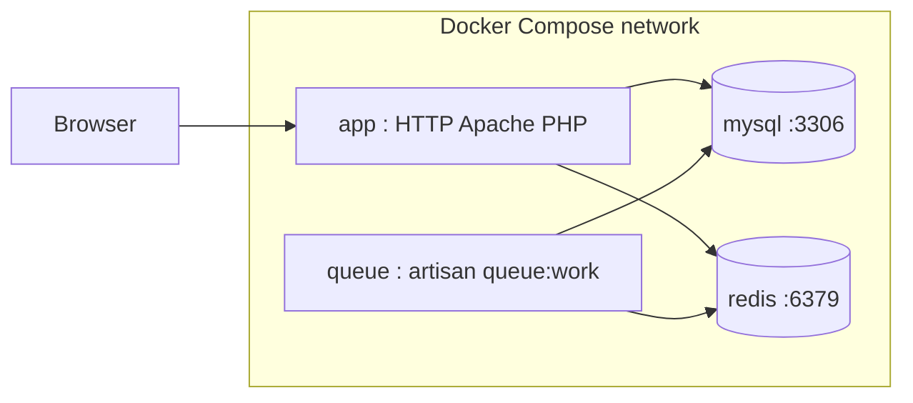

# Phase 11 — Docker Compose infrastructure

This document describes the **optional** container stack for Stone ERP AI on a **Docker-capable** host. It does **not** replace or modify the Windows local workflow (PHP, MySQL, Memurai, `scripts/dev.cmd`, etc.).

## Architecture overview



- **app**: Laravel served by **Apache** with document root `public/`. Frontend assets are built at **image build time** (Vite) and copied to `public/build`.
- **mysql**: **MySQL 8.4** with a named volume for `/var/lib/mysql`. No host port is published; only containers on the Compose network can connect (hostname **`mysql`**).
- **redis**: **Redis 7** with AOF persistence (`appendonly yes`) on a named volume.
- **queue**: Same image as **app**, command overridden to `php artisan queue:work redis` (does **not** run migrations).

Internal Docker DNS: Laravel must use **`DB_HOST=mysql`** and **`REDIS_HOST=redis`**, not `127.0.0.1`.

## Files

| Path | Purpose |
|------|---------|
| `Dockerfile` | Multi-stage build: Node builds Vite assets → PHP 8.3 Apache image with Composer `--no-dev`, required extensions, production-oriented `php.ini` snippet. |
| `docker-compose.yml` | Services `app`, `queue`, `mysql`, `redis`; named volumes for DB, Redis AOF, and app `storage`. |
| `.dockerignore` | Excludes `vendor`, `node_modules`, local `.env`, `docker/compose.env`, Windows `tools/`, etc., from the build context. |
| `docker/compose.env.example` | Template for **`docker/compose.env`** (gitignored). Copy and set secrets; pass to Compose with `--env-file`. |
| `docker/entrypoint.sh` | Ensures `storage` skeleton on first run when `storage` is a volume; fixes permissions for Apache. |
| `docker/apache/000-stoneerp.conf` | Apache vhost: `DocumentRoot` → `/var/www/html/public`, `AllowOverride All` for Laravel routing. |
| `docker/php/conf.d/stoneerp.ini` | Safe defaults: `expose_php=Off`, sensible limits, production Opcache settings. |

## Environment variables (names match `.env.example`)

Set these in **`docker/compose.env`** (from `docker/compose.env.example`). Do **not** commit real passwords or `APP_KEY`.

| Variable | Role |
|----------|------|
| `APP_PORT` | Host port mapped to app `80` (default `8080`). |
| `APP_NAME`, `APP_ENV`, `APP_KEY`, `APP_DEBUG`, `APP_URL` | Laravel application identity and encryption key. |
| `DB_*` | **`DB_HOST=mysql`**, **`DB_PORT=3306`** inside Compose; user/password must match MySQL service. |
| `REDIS_*` | **`REDIS_HOST=redis`**, **`REDIS_CLIENT=predis`** (matches `composer.json` / app default). |
| `QUEUE_CONNECTION` | Use **`redis`** for async workers. |
| `CACHE_STORE`, `SESSION_DRIVER` | Default stack uses **database** for cache and sessions (requires migrations). |
| `AI_PROVIDER`, `OPENAI_API_KEY` | OpenAI client package requires a non-empty placeholder for container boot; use a dummy value until you configure a **real** key for live AI calls (see template in `docker/compose.env.example`). |
| `MYSQL_ROOT_PASSWORD`, `MYSQL_DATABASE`, `MYSQL_USER`, `MYSQL_PASSWORD` | Official MySQL image: creates DB and user on first initialization. |

Never check in **`docker/compose.env`** (it is in `.gitignore`).

## First-run sequence (on a Docker-capable machine)

1. **Copy env file**  
   `cp docker/compose.env.example docker/compose.env`  
   Set strong passwords, **`APP_KEY`** (`php artisan key:generate --show` on any machine with Laravel), and adjust `APP_URL`/`APP_PORT` if needed.

2. **Validate Compose file**  
   `docker compose --env-file docker/compose.env config`

3. **Build and start**  
   `docker compose --env-file docker/compose.env up -d --build`

4. **Wait for health**  
   `docker compose --env-file docker/compose.env ps`

5. **Application key inside running app** (if `APP_KEY` was empty in env file, generate and update compose env, then recreate):  
   `docker compose --env-file docker/compose.env exec app php artisan key:generate --force`

6. **Migrations**  
   `docker compose --env-file docker/compose.env exec app php artisan migrate --force`

7. **ERP seed data (idempotent)**  
   `docker compose --env-file docker/compose.env exec app php artisan db:seed --force`

8. **Demo users (opt-in)**  
   Set `DEMO_USER_PASSWORD` in `docker/compose.env`, then:  
   `docker compose --env-file docker/compose.env exec app php artisan db:seed --class=Database\\Seeders\\DemoUserSeeder --force`  
   Do **not** commit passwords. DemoUserSeeder refuses to run without `DEMO_USER_PASSWORD`.

Do **not** run `migrate:fresh` or destructive resets against production or shared databases.

## Queue worker

- **Service**: `queue` runs `php artisan queue:work redis --sleep=3 --tries=3 --max-time=3600`.
- **Retries**: `--tries=3` and Laravel `retry_after` (default **90** seconds in `config/queue.php` for `redis`) apply to failed jobs.
- **Migrations**: The worker command does **not** run migrations (only `queue:work`).
- **Logs**: `docker compose --env-file docker/compose.env logs -f queue`
- **Restart**: `docker compose --env-file docker/compose.env restart queue`

Whether **all** AI traffic is asynchronous depends on application code: only actions that **dispatch jobs** use the queue; synchronous code paths remain synchronous.

## Logs and troubleshooting

- **App (Apache)**: `docker compose --env-file docker/compose.env logs -f app`
- **MySQL**: `docker compose --env-file docker/compose.env logs -f mysql`
- **Redis**: `docker compose --env-file docker/compose.env logs -f redis`
- **Health**: App exposes Laravel’s `GET /up`; Compose healthcheck curls `http://127.0.0.1/up` inside the container.

Common issues:

- **Connection refused to DB/Redis**: Confirm `DB_HOST` / `REDIS_HOST` are service names (`mysql`, `redis`), not `127.0.0.1`.
- **Permission errors on `storage`**: Recreate the `app` container; entrypoint seeds an empty `storage` volume from `/opt/storage-skeleton`.
- **OpenAI “API key missing” at runtime**: Ensure `OPENAI_API_KEY` is set (placeholder is acceptable for bootstrapping; use a real key for live calls).

## Stopping and data retention

- **Stop containers without removing volumes**:  
  `docker compose --env-file docker/compose.env down`  
  Database and Redis AOF data persist in named volumes (`mysql_data`, `redis_data`, `app_storage`).

## Removing volumes (destructive)

**Warning: this deletes the MySQL database, Redis data, and Laravel `storage` volume contents.**

```bash
docker compose --env-file docker/compose.env down -v
```

## Networking vs Windows localhost

| Environment | DB host | Redis host |
|-------------|---------|------------|
| Windows local `.env` | `127.0.0.1` (often `DB_PORT=3307`) | `127.0.0.1` |
| Docker Compose | **`mysql`** | **`redis`** |

Compose services resolve each other by **service name** on an internal bridge network. The app is reached from the host at `http://localhost:${APP_PORT}` (default **8080**). MySQL and Redis are **not** published to the host by default.

## Security notes

- **Secrets**: Use `docker/compose.env` locally; never bake `.env` into the image (`.dockerignore` excludes it).
- **Ports**: Only **app** publishes a host port; DB and Redis stay internal.
- **Root**: Apache runs as **`www-data`**; the main process is not required to run as root inside the app container for normal operation.
- **Debug**: Example compose env uses `APP_DEBUG=false` for a production-like default.
- **Images**: PHP, MySQL, Redis, Node, and Composer images use current stable tags (`php:8.3-apache-bookworm`, `mysql:8.4`, `redis:7-alpine`, etc.).

## Commands reference (run only where Docker is available)

```bash
docker compose --env-file docker/compose.env config
docker compose --env-file docker/compose.env build
docker compose --env-file docker/compose.env up -d
docker compose --env-file docker/compose.env exec app php artisan migrate --force
docker compose --env-file docker/compose.env exec app php artisan db:seed --force
docker compose --env-file docker/compose.env logs -f queue
```

## Validation on hosts without Docker

This repository can still be validated without running containers: review YAML/Dockerfile paths, variable names vs `.env.example`, and run `composer validate`, `php artisan test`, `npm test`, and `npm run build` locally (as in Phase 11 checklist).
