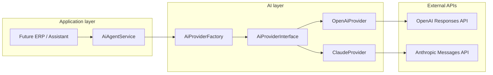

# Phase 6.1 — AI provider architecture

Provider-independent AI layer for Stone ERP Assistant. ERP services and future `/api/assistant` endpoints must depend on `AiAgentService` and DTOs — never on OpenAI or Anthropic SDK types.

## Why a provider interface?

- Swap OpenAI, Claude, Bedrock, Gemini, or Groq without rewriting business logic.
- Normalize requests/responses (messages, tools, token usage, finish status).
- Centralize error handling and credential checks.
- Keep secrets out of logs and API responses.

## Architecture



## Core types

| Type | Role |
|------|------|
| `AiRequest` | Messages, optional system instruction, optional tool definitions, optional model override |
| `AiMessage` | `system`, `user`, `assistant`, `tool` (tool execution not implemented in 6.1) |
| `AiResponse` | Text, provider/model ids, token usage, finish status, normalized tool calls |
| `AiToolDefinition` / `AiToolCall` | Schema for future function calling (no execution in 6.1) |
| `AiProviderException` | Safe application errors (missing key, auth, rate limit, timeout, etc.) |

## Factory

`AiProviderFactory::make()` reads `config('ai.provider')`:

| Value | Implementation |
|-------|----------------|
| `openai` | `OpenAiProvider` |
| `claude` / `anthropic` | `ClaudeProvider` |
| `ollama` | `OllamaProvider` |
| `bedrock`, `gemini`, `groq` | Clear “not implemented” exception |

Register new providers in the factory only; ERP code stays unchanged.

## OpenAiProvider

- Uses `openai-php/laravel` (`ClientContract`) **only inside** `OpenAiProvider`.
- Calls the **Responses API** (`responses()->create()`).
- Maps `instructions` + `input` message items (`input_text`).
- Maps `CreateResponse` → `AiResponse` (text, usage, function tool calls).
- Converts SDK errors → `AiProviderException` (no API keys in messages).

## ClaudeProvider

- Uses Laravel HTTP client against Anthropic **Messages API** (`/v1/messages`).
- No Anthropic SDK in application services.
- Maps system prompt, messages, optional tools, usage blocks → `AiResponse`.

## OllamaProvider

- Uses Laravel HTTP client against a configured Ollama host (**`POST /api/chat`**, non-streaming).
- Sends native `tools` definitions; parses `message.tool_calls` into normalized `AiToolCall` DTOs.
- Tool-loop continuation uses `OllamaToolCallingDriver` (assistant message + `role: tool` results in chat history).
- Optional usage: `prompt_eval_count` / `eval_count` when Ollama returns them.
- **`POST /api/generate`** is for simple text generation only (optional smoke tests); the ERP agent does **not** use it for tools.

## AiAgentService

Thin facade:

1. Resolve provider from factory.
2. Call `complete(AiRequest)`.
3. Return `AiResponse` or rethrow `AiProviderException`.

No conversation history, tool loops, or ERP integration in Phase 6.1.

## Phase 6.3 — Tool-calling loop (orchestration)

Multi-step tool use is implemented in `AiToolCallingService`, which depends on `AiToolCallingDriverInterface` for provider-specific continuation (Responses API vs Messages API). See `docs/PHASE6-AI-TOOL-CALLING.md`.

## Phase 7 — Conversations and hybrid context

Persistent conversations, follow-up resolution, summaries, and trusted proposal keys are documented in `docs/PHASE7-CONVERSATIONS-AND-CONTEXT.md`. The assistant HTTP API is deferred to Phase 8.

## Configuration

File: `config/ai.php` (env-driven).

| Variable | Purpose |
|----------|---------|
| `AI_PROVIDER` | `openai` (default), `claude`, or `ollama` |
| `OPENAI_API_KEY` | OpenAI key (local `.env` only) |
| `OPENAI_MODEL` | Default model (e.g. `gpt-4o-mini`) |
| `OPENAI_ORGANIZATION` | Optional |
| `OPENAI_PROJECT` | Optional |
| `OPENAI_REQUEST_TIMEOUT` | Seconds |
| `ANTHROPIC_API_KEY` | Claude key |
| `ANTHROPIC_MODEL` | Default Claude model |
| `ANTHROPIC_API_VERSION` | API version header |
| `ANTHROPIC_BASE_URL` | Default `https://api.anthropic.com` |
| `ANTHROPIC_REQUEST_TIMEOUT` | Seconds |
| `ANTHROPIC_MAX_OUTPUT_TOKENS` | Claude `max_tokens` |
| `AI_OLLAMA_BASE_URL` | Ollama server base URL (no trailing slash required) |
| `AI_OLLAMA_MODEL` | Model tag (e.g. `llama3.1:8b`) |
| `AI_OLLAMA_TIMEOUT` | Chat request timeout (seconds) |
| `AI_OLLAMA_CONNECT_TIMEOUT` | TCP connect timeout (seconds) |
| `AI_OLLAMA_KEEP_ALIVE` | Ollama `keep_alive` (e.g. `5m`) |
| `AI_MAX_TOOL_ITERATIONS` | Tool loop rounds (Phase 6.3) |
| `AI_MAX_TOOL_CALLS` | Max executed tool calls per run (Phase 6.3) |

Copy placeholders from `.env.example`. **Never commit real keys.**

## Manual verification (real API — local only)

After setting `OPENAI_API_KEY`, Claude credentials, or a reachable `AI_OLLAMA_BASE_URL` in `.env`:

```bash
.\scripts\dev.cmd php artisan ai:verify-connection
```

Uses `AiAgentService` with a fixed test prompt. Prints provider, model, response text, and token usage. Does **not** print keys. Automated tests do **not** run this command.

## Adding another provider later

1. Implement `AiProviderInterface` under `app/Services/AI/Providers/`.
2. Add config block in `config/ai.php`.
3. Register in `AiProviderFactory::make()`.
4. Bind in container if needed (`AiServiceProvider`).
5. Add faked HTTP/SDK tests (no live calls).

Files that typically change: new provider class, `AiProviderFactory`, `config/ai.php`, `.env.example`, tests, this doc.

## Testing without live APIs

- **OpenAI:** `OpenAI::fake()` + `CreateResponse::fake()` (package test doubles).
- **Claude:** `Http::fake()` on Anthropic endpoints.
- PHPUnit sets a dummy `OPENAI_API_KEY` so the OpenAI Laravel client can boot; fakes prevent network I/O.

## Related docs

- `docs/PHASE6-AI-TOOLS.md` — ERP tool registry and executor (Phase 6.2)
- `docs/PHASE6-AI-TOOL-CALLING.md` — tool-calling loop (Phase 6.3)
- `docs/PHASE7-CONVERSATIONS-AND-CONTEXT.md` — persistence and context (Phase 7)
- `docs/PHASE8-ASSISTANT-API.md` — authenticated `POST /api/assistant` orchestration (Phase 8)
- `docs/PHASE5-API.md`
- `docs/PHASE4-DRAFT-PO-WORKFLOW.md`
