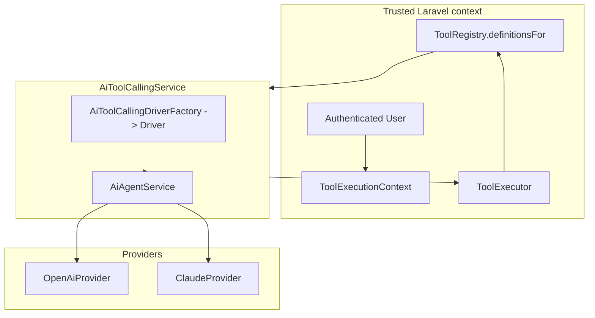

# Phase 6.3 — Provider-independent AI tool-calling loop

## Why this layer exists

ERP data and actions must never be driven by raw model text (SQL, PHP, or guessed endpoints). The model instead emits **normalized tool calls** (name + JSON arguments). The server **allowlists** tools, **validates** arguments, enforces **authorization**, runs only `ToolExecutor`, and returns **safe JSON** back to the model so it can produce a final natural-language answer.

This phase wires **one orchestration service** to **both** OpenAI (Responses API) and Anthropic (Messages API) without duplicating ERP logic inside providers.

## Architecture

**Responsibilities**

| Component | Role |
|-----------|------|
| `AiToolCallingService` | Iteration limits, duplicate-call guard, token aggregation, calls `ToolExecutor` per `AiToolCall`, builds the next `AiRequest` **via a driver** (no OpenAI/Anthropic imports). |
| `AiToolCallingDriverInterface` | Provider-specific translation: first request shape and “send tool results back” continuation (`OpenAiToolCallingDriver`, `ClaudeToolCallingDriver`). |
| `AiAgentService` | Single entry to `AiProviderFactory` → `complete(AiRequest)`. |
| `ToolRegistry` | Permitted `AiToolDefinition[]` for the user (defense in depth). |
| `ToolExecutor` | Strip forbidden keys, resolve tool, `allowedFor`, execute, safe errors. |
| `OpenAiProvider` | Responses API: instructions + `input` items; tool round-trips use `previous_response_id` + `function_call_output` **items** (SDK-shaped: `call_id`, `output`, `type` only in the HTTP payload). |
| `ClaudeProvider` | Messages API: `messages` + `tools` + optional `tool_choice`; parses `tool_use` blocks; stores prior `messages` on `AiResponse::claudeConversationExtension` for the driver. |

## Normalized protocol (DTOs)

- `AiRequest`: initial `messages`, optional `systemInstruction`, optional continuation fields (`openaiPreviousResponseId` + `openaiToolOutputInput`, or `claudeMessages`).
- `AiResponse`: `text`, `toolCalls` (`AiToolCall` with provider **tool use / call id**), usage, `claudeAssistantBlocks` + `claudeConversationExtension` (Claude loop).
- Tool results are **not** new DTO types in the public ERP API; they are `ToolExecutionResult` serialized to JSON strings in provider-specific follow-up requests.

## OpenAI Responses API — tool calling

1. First call: `input` = user/assistant messages as `input_text` items; `tools` = `function` schemas from `AiToolDefinition`; `tool_choice` when tools exist.
2. When `output` contains `function_call` items, `OpenAiProvider` maps them to `AiToolCall` using the provider **call id** (`call_id` preferred over item `id`).
3. The loop sends **only** `function_call_output` items as the next `input`, with `previous_response_id` set to the prior response’s `id`. Extra fields such as a client-side `id` for outputs are stripped before the SDK call so the payload matches the Responses API contract.
4. The cycle repeats until there are no tool calls in `output` (final assistant text) or a **limit** / **guard** fires.

## Anthropic Messages API — tool calling

1. First call: `messages` built from normalized `AiMessage` list (system merged into `system` string); `tools` use `input_schema` from JSON Schema; `tool_choice` `{ "type": "auto" }` when tools exist.
2. Assistant turns with `tool_use` blocks are captured in `AiResponse::claudeAssistantBlocks`; the prior request `messages` snapshot is stored in `claudeConversationExtension`.
3. For each `tool_use.id`, the executor runs the tool; results are sent as the next user message whose `content` is an array of `tool_result` blocks (`tool_use_id` + JSON string `content`).
4. Ordering is always: **assistant (tool_use blocks) → user (tool_result blocks)** per Anthropic rules.

## Tool ids and results

- OpenAI: correlate with `call_id` on `function_call` / `function_call_output`.
- Claude: correlate with `tool_use.id` and `tool_result.tool_use_id`.
- The orchestration service never rewrites ids; it passes `AiToolCall` objects straight to `ToolExecutor`.

## Authorization and security

- Only `ToolRegistry` tools run; unknown names → `ToolExecutionResult` error, not an exception (the model may continue).
- `ToolExecutor` rejects forbidden argument keys (`user_id`, `conversation_key`, `idempotency_key`, …) and **invalid JSON disguised as `{ "raw": "..." }`** (OpenAI decode fallback).
- Trusted proposal fields **must** come from `ToolExecutionContext`; the draft proposal tool fails with `missing_trusted_context` if absent.
- Internal errors do not leak stack traces into tool JSON.

## Multiple tool calls

All calls in one assistant turn are executed **sequentially** (same order as returned). Each maps to a distinct id. One failure does not break id association for sibling calls.

## Loop limits (`config('ai.tool_loop')`)

| Setting | Env | Default | Behavior |
|---------|-----|---------|----------|
| `max_iterations` | `AI_MAX_TOOL_ITERATIONS` | `8` | Counts provider rounds **where the model returned ≥1 tool call**. |
| `max_tool_calls` | `AI_MAX_TOOL_CALLS` | `32` | Hard cap on **executed** tool calls in one `run()`. |

Additional guard: if the model requests the **same tool names and arguments** as the previous batch (stable fingerprint), `AiToolLoopException` (`repeated_identical_tool_calls`) is thrown to prevent infinite loops.

When limits are hit, the service throws `AiToolLoopException` — it does **not** invent a final assistant answer.

## Draft purchase order safety

`proposeDraftPurchaseOrder` may appear in the loop but only creates a **pending** proposal via trusted `conversationKey` and `idempotencyKey`. There is **no** AI tool to confirm proposals; confirmation stays on the explicit API from Phase 4.

## Token usage aggregation

`AiToolCallingService` sums `inputTokens`, `outputTokens`, and `totalTokens` from each `AiResponse` that provides them. Missing usage is treated as zero for the running sum; `AiToolCallingOutcome` exposes nullable totals when the aggregate is still zero.

## Adding another provider

1. Implement `AiProviderInterface`.
2. Add an `AiToolCallingDriverInterface` implementation if tool continuation differs.
3. Register the driver in `AiToolCallingDriverFactory`.
4. ERP tools and `ToolExecutor` stay unchanged.

## Example — stock lookup end to end

1. **User** (normalized `AiMessage::user`): “How many Calacatta 3 cm slabs are in Houston?”
2. **`AiToolCallingService::run`** loads permitted tools for the user, picks a driver from `config('ai.provider')`.
3. **First provider request** includes tool definitions; the model returns `checkStock` with filters.
4. **`ToolExecutor`** validates arguments, calls `StockLookupService`; JSON result (no costs) goes back via `function_call_output` (OpenAI) or `tool_result` (Claude).
5. **Second provider request** carries no user text, only tool outputs and linkage ids.
6. **Final** assistant message summarizes: e.g. “42 slabs on hand in Houston.”

## Related docs

- `docs/PHASE6-AI-ARCHITECTURE.md`
- `docs/PHASE6-AI-TOOLS.md`
- `docs/PHASE5-API.md`
