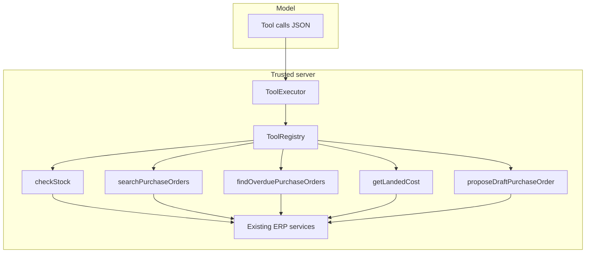

# Phase 6.2 — ERP AI tools, registry, and secure execution

## Why this exists

Large language models must **not** run SQL, arbitrary PHP, or raw Eloquent against ERP data. Instead they request **named, allowlisted tools**. Laravel validates arguments, enforces `Gate` abilities via existing ERP services, and returns **normalized JSON** the assistant can use in a later orchestration phase.

## Architecture

## Tool registry

`App\Services\AI\Tools\ToolRegistry` registers exactly five implementations. Unknown tool names are not resolvable. `definitionsFor(User)` returns only tools the user’s role may see (so the model is not prompted with forbidden tools — defense in depth; **executor still checks** `allowedFor`).

## Tool executor

`App\Services\AI\Tools\ToolExecutor`:

1. Strips **forbidden argument keys** (`user_id`, `role`, `token`, `conversation_key`, `idempotency_key`, …). If any appear, the call fails with `forbidden_arguments`.
2. Resolves the tool by **exact** registered name.
3. Verifies `allowedFor($user)` again.
4. Delegates to the tool, which validates allowlisted keys and calls the ERP service.
5. Catches unexpected exceptions and returns `internal_error` **without** stack traces or SQL.

**Trusted context** (`ToolExecutionContext`): authenticated `User` plus optional `conversationKey` and `idempotencyKey` for proposals — **never taken from model JSON**.

## Registered tools

| Name | Service | Sales | Purchasing |
|------|---------|-------|-------------|
| `checkStock` | `StockLookupService::stockForProductAtWarehouseByAttributes` | Yes | Yes |
| `searchPurchaseOrders` | `PurchaseOrderLookupService::search` | Yes | Yes |
| `findOverduePurchaseOrders` | `OverduePurchaseOrderService::listOverdue` | Yes | Yes |
| `getLandedCost` | `LandedCostService::calculateForPurchaseOrder` | No | Yes |
| `proposeDraftPurchaseOrder` | `DraftPurchaseOrderService::createProposal` | No | Yes |

`checkStock` uses attribute filters aligned with the service (product SKU/material/color/thickness, warehouse name/city). Output is the service array (`found`, `product`, `warehouse`, `slabs_on_hand`, etc.) — **no costs**.

`searchPurchaseOrders` maps: `date_from`/`date_to` → `order_date_from`/`order_date_to`, optional `status`, `supplier_name`, `limit`, `page`. Matches service limits (max **200**).

`findOverduePurchaseOrders` maps optional `as_of` and `limit` (max **500**). Overdue semantics remain those of `OverduePurchaseOrderService`.

`getLandedCost` requires `purchase_order_id`. Uses existing calculation and errors; failures return a generic message (no leaked internals).

`proposeDraftPurchaseOrder` creates **only** a pending proposal. It requires **server-supplied** `conversationKey` and `idempotencyKey` on `ToolExecutionContext`. Model cannot confirm proposals; HTTP Phase 5.2 remains the confirmation path.

## Provider compatibility (OpenAI / Claude)

Tools use a single `AiToolDefinition` DTO. `OpenAiProvider` maps it to Responses API function tools; `ClaudeProvider` maps `parameters` → `input_schema`. **One registry** — no per-provider duplication.

## Adding a tool safely

1. Implement `AiToolInterface` under `App\Services\AI\Tools\Definitions\`.
2. Register the class in `AiServiceProvider`’s `ToolRegistry` constructor list.
3. Add focused tests under `tests/Feature/AI/Tools/`.
4. Document the schema and ERP mapping here.

## End-to-end example (conceptual)

**Purchasing user**, trusted context `conversationKey=session-abc`, `idempotencyKey=server-uuid-1`.

1. Model returns tool call `proposeDraftPurchaseOrder` with supplier, dates, lines (costs allowed for Purchasing).
2. Executor rejects if `conversation_key` appears in arguments (must use context).
3. `DraftPurchaseOrderService::createProposal` runs; returns proposal id and expiry — **no PO rows**.

Later, a human confirms via `POST /api/purchase-order-proposals/{id}/confirm` (Phase 5.2) — out of scope for tool execution.

## Related

- `docs/PHASE6-AI-ARCHITECTURE.md`
- `docs/PHASE6-AI-TOOL-CALLING.md` — orchestrated multi-step tool execution (Phase 6.3)
- Phase 5.2 proposal API (`docs/PHASE5-API.md`)
