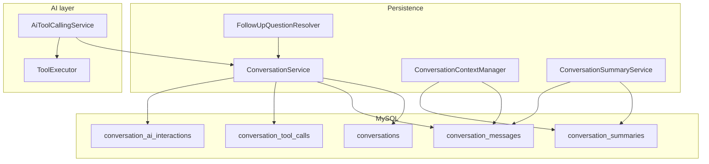

# Phase 7 — Conversation persistence and hybrid context management

## Why this exists

The assistant must **remember** user turns, **audit** AI usage, and supply **trusted** conversation scope to sensitive tools (for example `proposeDraftPurchaseOrder`) without trusting the model for user IDs, conversation keys, or idempotency. Full history stays in MySQL; only a **bounded slice** is sent to the provider for each request.

## Database design

| Table | Purpose |
|-------|---------|
| `conversations` | `public_id` (UUID, external identifier), `user_id`, title, status, `last_activity_at` |
| `conversation_messages` | Chronological rows: roles `system`, `user`, `assistant`, `tool`; `metadata` for resolution; `turn_idempotency_key` (unique per turn); `is_internal` for prompts not shown in ordinary history |
| `conversation_tool_calls` | Provider call id, tool name, JSON arguments, redacted `safe_result`, status, link to user turn and optional `tool_result` message; uniqueness uses **`(conversation_id, user_message_id, provider_tool_call_id)`** (short index name `conv_tool_calls_conv_user_msg_provider_uc`) because some providers reuse call ids across assistant turns within the same conversation |
| `conversation_summaries` | Versioned summary text, `last_summarized_message_id` + `last_summarized_sequence` (incremental refresh) |
| `conversation_ai_interactions` | Token totals, tool counts, duration, completion, optional error code |

ERP tables and confirmed POs are **not** cascaded from conversations; proposal rows remain keyed by `conversation_key` + `idempotency_key` as in Phase 5.

## Architecture

## Message and tool-call persistence

- **User** rows store the **original** text in `content`. If `FollowUpQuestionResolver` expands a follow-up, the standalone form is stored in `metadata.resolved_standalone_question` only.
- **Assistant** rows store the final answer text for that turn (plus provider/model metadata where useful).
- **Tool** rows store JSON from `ToolExecutionResult::toArray()` after **redaction** (`ToolResultRedactor` drops keys like `bank_details`, tokens, etc.).
- **Parallel table** `conversation_tool_calls` stores structured arguments, status, and links `user_message_id` → the user turn that triggered the model.

## Ownership and security

- `ConversationService::getOwnedByPublicId` and `assertOwned` enforce **same user** on every mutating call.
- **Never** trust `user_id` or `conversation_key` from tool arguments (`ToolExecutor` already strips forbidden keys).
- Trusted proposal scope: `ToolExecutionContext.conversationKey` defaults to `Conversation::public_id` when `AiConversationRecording` is passed into `AiToolCallingService::run`.
- **Idempotency**: `turn_idempotency_key` on the user message is used as `ToolExecutionContext.idempotencyKey` for that turn (server-generated UUID).

## Context retrieval (`ConversationContextManager`)

1. Optionally prepend the **latest** summary as a `system` message (explicitly labeled as a summary).
2. Take the **most recent** non-internal messages up to `config('ai.conversation.context.max_messages')`, staying under `max_chars`.
3. Map `tool` rows back to `AiMessage::toolResult` with parsed JSON payloads.

Full history remains in `conversation_messages`; the slice is only for model input.

## Follow-up resolution (`FollowUpQuestionResolver`)

1. **Standalone heuristic** — long questions or clear “how many / show / …” patterns skip resolution.
2. **Deterministic rules** (no AI):
   - `And in Dallas?` when the prior question mentions Houston/Dallas/Austin → city swap in the prior **resolved or raw** user text.
   - `What about 2cm?` → thickness swap.
   - `What about Supplier X?` when the prior question mentions “Supplier …” → supplier fragment swap.
3. **AI resolution** — if `config('ai.conversation.follow_up.use_ai_when_ambiguous')` is true, a **no-tools** `AiAgentService` call asks for **JSON only** describing resolved vs clarification. On failure, the service returns a clarification request, never a guessed rewrite.

## Summary generation (`ConversationSummaryService`)

- Triggered after a turn when there are enough messages (`AI_SUMMARY_MIN_MESSAGES`) **and** at least `AI_SUMMARY_REFRESH_INTERVAL` **new** messages since `last_summarized_sequence`.
- Uses `AiAgentService` **without** ERP tools; instructs the model not to invent facts.
- Failures are swallowed so persistence never breaks.

## Integrating `AiToolCallingService`

Optional parameters:

- `AiConversationRecording` — wires `Conversation`, user message, and `ConversationService` for post-run persistence and trusted keys.
- `systemInstruction` — merged as a leading `AiMessage::system` (e.g. internal routing); stored only if you append via `ConversationService` yourself for Phase 8.

On provider/loop errors, the service returns a **safe** `AiToolCallingOutcome` with `completed: false` and still records assistant + interaction when recording is enabled.

## End-to-end follow-up examples

**Stock / city**

1. User: “How many 3cm Calacatta slabs are in Houston?”
2. Assistant answers from tools.
3. User: “And in Dallas?”
4. Resolver → resolved: “How many 3cm Calacatta slabs are in Dallas?” (deterministic). Original “And in Dallas?” remains in `content`.

**Overdue / supplier**

1. User: “Show overdue purchase orders for Supplier Alpha Tools.”
2. User: “What about Supplier Beta?”
3. Resolver substitutes the supplier phrase deterministically.

## Local setup and test database

- Copy `.env.testing.example` to **`.env.testing`** (ignored by git) and set **`DB_PASSWORD`** (and host/port) to match your MySQL user that can access **`stone_erp_ai_test`** only.
- If tests fail with missing `migrations` or “table already exists” errors, the test schema is corrupted — repair with  
  `.\scripts\dev.cmd php artisan migrate:fresh --env=testing --force`  
  (targets only the database in `.env.testing`, default `stone_erp_ai_test` per `phpunit.xml`).

## Related docs

- `docs/PHASE8-ASSISTANT-API.md` — main API entry point using this persistence layer
- `docs/PHASE6-AI-ARCHITECTURE.md`
- `docs/PHASE6-AI-TOOLS.md`
- `docs/PHASE6-AI-TOOL-CALLING.md`
- Phase 5 proposal API: `docs/PHASE5-API.md`
