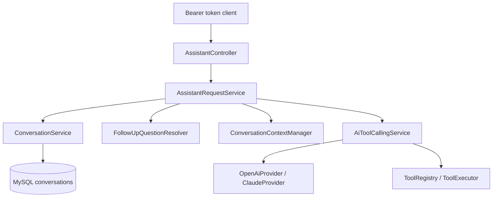

# Phase 8 — Authenticated assistant API

## Endpoint

- **Method / path:** `POST /api/assistant`
- **Authentication:** Laravel Sanctum (`Authorization: Bearer <token>`). Unauthenticated requests return **401**.
- **Authorization:** Sales and Purchasing users may call the endpoint. ERP tool availability still follows role rules inside `ToolRegistry`.
- **Rate limiting:** Named limiter `api-assistant` (default **60 requests per user per minute**, configurable via `AI_ASSISTANT_RATE_LIMIT`). Exceeded → **429** with Laravel’s standard throttle response.

## Request body

Only these fields are accepted (extra keys → **422**):

| Field | Rules |
|-------|--------|
| `message` | Required, string, non-empty after trim, max length from `AI_ASSISTANT_MAX_MESSAGE_CHARS` (default 4000). |
| `conversation_id` | Optional, nullable, UUID. When omitted, a **new** conversation is created. When set, must be an existing conversation **owned** by the user. **Required** when the `Idempotency-Key` header is sent (Phase 9). |

The client must **not** send user id, role, tools, system prompts, or provider keys.

### Optional header: `Idempotency-Key`

When present (non-empty after trim), the server treats the turn as **HTTP-idempotent** for that authenticated user within the given `conversation_id`:

- **422** if `conversation_id` is missing (same validation error shape as other field errors).
- **409** `idempotency_body_mismatch` if the same key was already used with a **different** `message` body in that conversation.
- **503** `idempotency_in_progress` while another request with the same key is still completing or the cached response is not stored yet (client should retry with backoff).

On success, the same key + same message returns the **same JSON payload** (replay from `conversation_messages.idempotency_response`) without re-running tools or the model. See `docs/PHASE9-END-TO-END-VERIFICATION.md` for design limits (cache lock, concurrent sessions).

## Response shape

JSON always includes `success` and usually `data`.

```json
{
  "success": true,
  "data": {
    "conversation_id": "<public uuid>",
    "message": "<assistant text or clarification>",
    "original_message": "<raw user text>",
    "resolved_question": "<standalone question passed to the model or null>",
    "clarification_required": false,
    "clarification_question": null,
    "provider": "openai",
    "model": "gpt-4o-mini",
    "usage": {
      "input_tokens": 100,
      "output_tokens": 40,
      "total_tokens": 140
    },
    "tool_calls": 1,
    "tool_iterations": 1,
    "completed": true,
    "incomplete_reason": null,
    "error_code": null
  }
}
```

- **Clarification path:** `clarification_required` is **true**, ERP tools are **not** executed, `provider` / `model` / `usage` are null. User and assistant clarification rows are persisted.
- **Failure path:** `success` is **false**, HTTP status is not always 200 (see below), `error.code` and `error.message` are present. `data` still includes safe assistant text and usage counters when the run produced a partial outcome.

Internal numeric database ids are not exposed in `data`.

## Architecture



## Lifecycle (orchestration)

1. **Validate** input (`AssistantChatRequest`).
2. **Resolve conversation:** create new or `getOwnedByPublicId` (unknown uuid → **404**, other user’s uuid → **403**).
3. **Require active** status (`active` only; archived/closed → **403** `conversation_inactive`).
4. **Persist user message first** (original text only), under row lock for that conversation.
5. **Follow-up resolution** (`FollowUpQuestionResolver`):
   - If clarification needed → persist resolution metadata, append assistant clarification, return **200** success without tools.
   - Else merge `resolved_standalone_question` + strategy into the **same** user row (`mergeUserMessageResolution`).
6. **Build context:** `ConversationContextManager::buildAiMessages` for prior turns, **excluding** the current user row id, plus **Sales users omit prior `getLandedCost` tool rows** from context (defense in depth).
7. **Build `AiRequest`:** system instruction (role-aware) + prior messages + current turn as `AiMessage::user(resolved question)`.
8. **Run tools:** `AiToolCallingService::run` with `AiConversationRecording` (trusted `conversation_key` + `turn_idempotency_key` from the user message; see Phase 7).
9. **`AiToolCallingOutcome` → HTTP:** map provider / loop errors to stable codes (see below). Successful model completion → **200** with `success: true`.

Summary refresh continues to run inside `AiToolCallingService` via existing `ConversationSummaryService` thresholds.

## Sales vs Purchasing

- **Tools** are filtered by `ToolRegistry::definitionsFor($user)` (same as Phase 6).
- **System prompt** reminds Sales not to discuss costs; Purchasing may use cost tools where registered.
- **Context:** Sales do not receive prior `getLandedCost` tool blobs in hybrid context (see `ConversationContextManager`).

## Draft purchase orders

- The model may call `proposeDraftPurchaseOrder` for **Purchasing** only.
- **Trusted** `conversation_key` and `turn_idempotency_key` come from server-side recording (not model arguments), same as Phase 7.
- The API does **not** confirm proposals; users must use existing `POST /api/purchase-order-proposals/{id}/confirm` (Phase 5.2).

## HTTP status mapping (assistant failures)

| Condition | HTTP | `error.code` (in `error` object) |
|-------------|------|-------------------------------------|
| Validation | 422 | Laravel validation messages |
| Unknown conversation | 404 | `conversation_not_found` |
| Other user’s conversation | 403 | `conversation_forbidden` |
| Inactive conversation | 403 | `conversation_inactive` |
| AI auth / missing key (provider) | 502 | `ai_authentication_failed` |
| AI rate limit | 429 | `ai_rate_limit` |
| AI timeout | 504 | `ai_timeout` |
| AI server error | 503 | `ai_server_error` |
| Invalid provider response | 502 | `ai_invalid_response` |
| Claude `max_tokens` / incomplete final | 200 | `assistant_response_incomplete` (`success`: false) |
| Max tool iterations | 422 | `tool_loop_limit` |
| Max tool calls | 422 | `tool_calls_limit` |
| Repeated identical tool batch | 422 | `tool_loop_repeated_calls` |
| Generic assistant failure | 503 | `assistant_execution_failed` |
| Idempotency key reused with different message | 409 | `idempotency_body_mismatch` |
| Idempotency key in progress / response not stored yet | 503 | `idempotency_in_progress` |
| Assistant throttle | 429 | (Laravel default) |

## Idempotency and concurrency

- **Per-turn idempotency** for proposals is the existing **`turn_idempotency_key`** on `conversation_messages` (server UUID per user message). Proposal confirmation still uses **`POST /api/purchase-order-proposals/{id}/confirm`** with its own `Idempotency-Key` (Phase 5.2).
- **Optional HTTP idempotency** (Phase 9): when the client sends **`Idempotency-Key`** + **`conversation_id`**, the assistant persists a row keyed by **`(conversation_id, client_idempotency_key)`** and replays the stored assistant outcome. Without that header, retries can still append duplicate user messages (client responsibility).

## Persistence note (tool call uniqueness)

`conversation_tool_calls` uses a unique key on **`(conversation_id, user_message_id, provider_tool_call_id)`** so providers that reuse call ids across turns in the same conversation do not collide.

## Local testing

1. Issue a token: `POST /api/auth/token` with demo credentials.
2. Call:

```http
POST /api/assistant
Authorization: Bearer <token>
Content-Type: application/json

{"message":"How many 3cm Calacatta slabs do we have in Houston?"}
```

3. Continue the thread with `"conversation_id": "<uuid from response>"`.

Use `AI_PROVIDER=openai` or `claude` as elsewhere.

## Related documentation

- `docs/PHASE6-AI-ARCHITECTURE.md`
- `docs/PHASE6-AI-TOOL-CALLING.md`
- `docs/PHASE7-CONVERSATIONS-AND-CONTEXT.md`
- `docs/PHASE5-API.md` (proposal confirmation)
